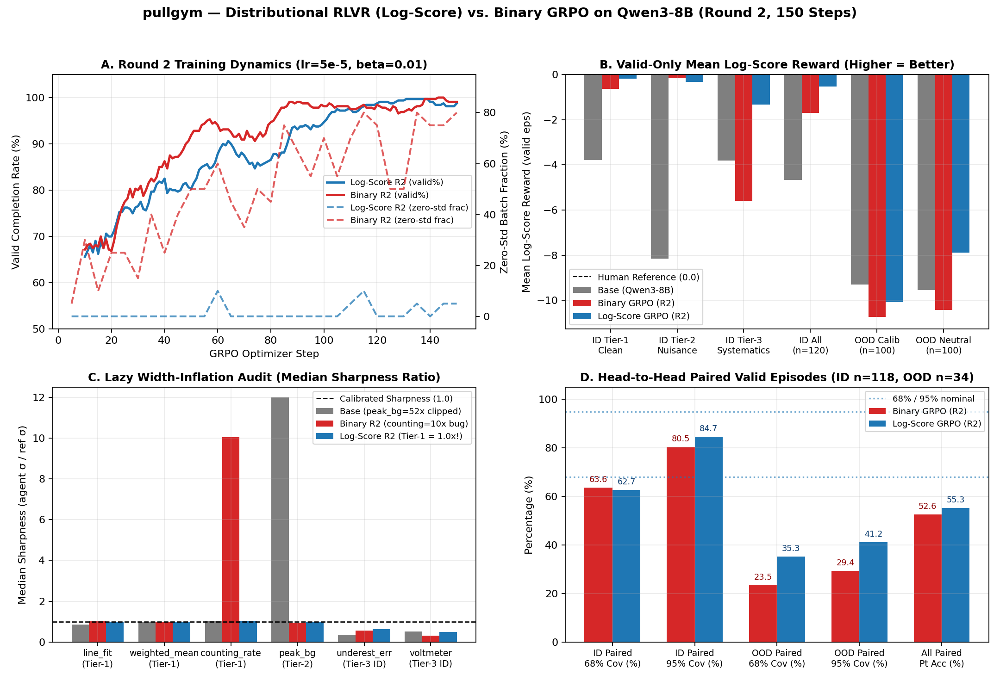

# pullgym

**Do AI agents report honest error bars?**

pullgym is an evaluation and RL environment. An agent gets data from a simulated physics experiment, analyses it with a shell and Python, and reports a measured value with its uncertainty. The environment knows the true value. It scores the agent on whether its error bars are honest: not too small (overconfident) and not too large (uselessly safe).

The question it answers:

> When an agent reports a 68% interval on a measured quantity, how often does the true value fall inside it? A calibrated analyst is right 68% of the time.

> **Status: v0.1 ready for release.** Twelve experiment families across four tiers, the scorer, the Harbor exporter, the fast runner and the reporting tool work, and every family's reference analysis is verified calibrated. Multi-turn commercial/open frontier baselines (`deepseek-flash` across `calibrated` and `neutral`, `kimi-k3.1-pro`, `qwen3.8-omni-flash`, `qwen/qwen3.8-27b`, and `nemotron-3-ultra-550b`) and controlled `Qwen3-8B` GRPO results (`log_score` vs. `binary` across two KL regimes, 1,600 evaluated episodes in [docs/RLVR_RESULTS.md](docs/RLVR_RESULTS.md)) are published below. Interfaces may change before v0.2.

## Why

Agents are increasingly asked to analyse data, not only write code. A wrong central value is easy to catch. A correct central value with an error bar three times too small is not, and it is the failure that matters most in experimental science.

Existing work measures nearby things:

- **Confidence in task success & calibration RL (`RLCR`, `CAPO`).** Agent uncertainty-quantification and recent calibration-aware GRPO papers use proper scoring rules (such as Brier scores) to calibrate a model's scalar verbalized confidence (*"80% sure my final answer is right"*) on discrete QA or math correctness. They do not test whether a code-writing agent propagates instrument systematics, nuisance parameters and physical boundaries into a continuous error bar on a measured quantity.
- **Distributional estimates without data.** [OpenEstimate](https://arxiv.org/abs/2510.15096) asks models for priors on real-world statistics and finds them often overconfident. The model gets no data and no tools.
- **Statistics question answering.** [StatABench](https://arxiv.org/abs/2606.22977) scores answers to statistics questions and modelling tasks.
- **Physics with simulators.** [PhysGym](https://arxiv.org/abs/2507.15550), PhysAgentGym and WorldSolver test law discovery or simulation code. [Collider-Bench](https://arxiv.org/abs/2605.13950) tests reproduction of LHC analyses.

pullgym scores the uncertainty itself, against a known truth, over many independent episodes. All scoring is computed from numbers, with no LLM judge.

## Quickstart

```bash
git clone https://github.com/kekeandzeyu/pullgym && cd pullgym
uv sync

uv run pullgym list                      # the experiment families
uv run pullgym calibrate --n 2000        # check every reference analysis is calibrated
uv run pullgym probe --n 500             # degenerate answering strategies vs the reference
uv run pullgym export --n 100 --out tasks    # Harbor task folders, dev split
```

Then run an agent on the tasks with [Harbor](https://www.harborframework.com/) and tabulate the results:

```bash
harbor run -p tasks -a <agent> -m <model> -o jobs
uv run pullgym report jobs               # coverage, pull and sharpness per model and family
```

## How an episode works

1. A **generator** draws hidden parameters θ from a prior, using a seed.
2. It simulates the experiment and writes the data files and an **apparatus note** to `/app/data`. The note gives the instrument resolution, calibration information and known quirks, as a lab logbook would.
3. The **agent** analyses the data however it likes, with Python, numpy, scipy, pandas and matplotlib available.
4. The agent writes its result to `/logs/artifacts/answer.json`.
5. The **verifier** runs in a separate, fresh sandbox, receives only that file, compares it with θ and writes a reward.

The physics is undergraduate lab level. The difficulty is the statistics: nuisance parameters, systematics, correlated errors, low counts and the cases where the honest answer is "not measured".

## Answer format

For each quantity, the agent reports five quantiles of its belief, at 2.5%, 16%, 50%, 84% and 97.5%:

```json
{
  "lifetime": {"q025": 21.3, "q16": 22.4, "q50": 23.0, "q84": 23.6, "q975": 24.7}
}
```

A Gaussian result `x ± σ` is close enough to `x − 2σ, x − σ, x, x + σ, x + 2σ`. Asymmetric low-count intervals and upper limits fit the same format. Quantiles must be finite numbers in strictly increasing order.

An answer that is missing or malformed is scored as if the agent had reported the prior (the quantiles an analyst who never looked at the data could honestly give), minus a penalty of 1. Giving up is therefore never better than an honest, uninformative answer.

## Scoring

| Level | Metric | What it tells you |
|---|---|---|
| Per episode (the reward) | A clipped log score: the log density of the reported distribution at the true value, in units of the reference analysis's σ, shifted so that a calibrated Gaussian as sharp as the reference averages 0, and clipped to [−20, +5] | A proper scoring rule: the expected reward is highest when the reported distribution matches the agent's actual belief. An overconfident miss costs about pull²/2, so error bars 10× too small average about −12, while error bars 10× too large average about −1.8. |
| Per episode (secondary) | `pinball_skill`: `1 − L / L₀`, with `L` the mean quantile (pinball) loss in reference-σ units and `L₀ ≈ 0.200` its expected value for a calibrated Gaussian as sharp as the reference | Also proper, but lenient on overconfidence, because its penalty grows only linearly with the miss. Reported for comparison, not used as the reward. |
| Per family | Coverage of the 68% (`q16`–`q84`) and 95% (`q025`–`q975`) intervals | The headline numbers: 68% and 95% when calibrated. |
| Per family | Pull = (`q50` − truth) / σ, with σ taken from the half-interval on the truth's side. Reported: mean, RMS and a robust width (half the 16–84 percentile range of the pulls) | The numbers physicists read: mean 0 and width 1 when calibrated. The robust width is reported alongside the RMS because a single wildly overconfident episode dominates the RMS. |
| Per family | Sharpness: the agent's σ divided by the reference analysis's σ | Separates "honest but sloppy" from "honest and efficient". |

To score the log density, the five quantiles are read as a full distribution: the quantile function is interpolated linearly in Gaussian z-space and extended past `q025` and `q975` with the outer slopes. A Gaussian answer becomes exactly that Gaussian, and an asymmetric answer becomes a piecewise-scaled Gaussian. The clip at −20 is reached at a pull of about 6.3. For a Gaussian belief it does not move the best answer away from the honest width. For a strongly heavy-tailed belief that the agent reports as a Gaussian, the best width shrinks by about 10%. An agent can avoid that by widening its outer quantiles.

`pullgym report` also shows 68% coverage in equal-count bins of the true value, so an analysis that is calibrated on average but fails near a physical boundary still shows up.

`reward.json` holds the per-episode numbers that Harbor aggregates. `details.json` holds the truth, the answer and any validation error, and is what `pullgym report` reads.

## Task families

| Tier | What makes it hard | Family | The experiment |
|---|---|---|---|
| 1. Clean statistics | Nothing; a sanity check | `line_fit` | A cart's velocity from positions with known Gaussian errors |
| | | `weighted_mean` | The speed of sound from several groups with very different stated errors |
| | | `counting_rate` | A Poisson count rate from repeated fixed-time counts |
| 2. Nuisance parameters | Something must be fitted or subtracted | `decay_background` | A lifetime from a binned decay curve over a flat background of unknown rate |
| | | `peak_background` | A gamma-ray line's energy on a sloped background, with the line width unknown |
| | | `low_count_rate` | A weak source's rate from a handful of counts, on and off source |
| 3. Systematics | The statistical error alone is wrong | `voltmeter_gain` | A voltage on a meter whose gain has a certified uncertainty |
| | | `underestimated_errors` | A resistance from a V–I curve whose stated error bars are too small by an unknown factor |
| | | `errors_xy` | A spring constant when the extension readings have errors as large as the force readings |
| | | `correlated_norm` | A density from runs over several days, each day sharing its own calibration error |
| | | `dead_time` | A true count rate behind a counter whose dead time is uncertain, giving an asymmetric interval |
| 4. Traps | The honest answer is a limit | `no_signal` | The strength of a faint line that is often indistinguishable from zero |

Planned beyond v0.1: outliers; many places to look for a peak (look-elsewhere); inconsistent units in the apparatus note.

### What the traps catch

Each family is built so that a common shortcut gives the wrong error bar. The table below scores those shortcuts with the same scorer the agents face, on 300 seeds per family.

| Family | Shortcut | Coverage 68% | Coverage 95% | Robust pull width | Sharpness | Reward |
|---|---|---|---|---|---|---|
| `voltmeter_gain` | Statistical error only, ignoring the gain certificate | 9% | 16% | 12.3 | 0.08 | −12.6 |
| `underestimated_errors` | Trust the stated error bars | 38% | 70% | 1.90 | 0.50 | −1.06 |
| `errors_xy` | Ignore the errors in x | 25% | 46% | 4.01 | 0.27 | −5.48 |
| `correlated_norm` | Treat all runs as independent | 11% | 23% | 5.98 | 0.17 | −8.33 |
| `correlated_norm` | Add the calibration error once, as if all days shared it | 88% | 100% | 0.59 | 1.71 | −0.22 |
| `dead_time` | Correct for dead time but ignore its uncertainty | 6% | 12% | 15.8 | 0.06 | −13.4 |
| `low_count_rate` | √N Gaussian errors | 67% | 94% | 0.97 | 1.29 | −0.48 |
| `no_signal` | Sideband-subtracted counts with √N Gaussian errors | 65% | 92% | 1.08 | 1.53 | −0.57 |

The reference analyses average a reward of about 0. In `low_count_rate` and `no_signal`, the Gaussian shortcut keeps roughly nominal coverage. It loses on sharpness and reward instead, because its interval is wider than the data support and runs into negative rates. Those two families test efficiency and respect for the physical boundary more than coverage.

### Reference analyses are calibrated

Every family ships a reference analysis written by a human. Before any model is run, it must reach nominal coverage on the family's own generator. Numbers below come from `pullgym calibrate --n 2000`; the standard error is 1.0 point on 68% coverage and 0.5 points on 95%.

| Family | Coverage 68% | Coverage 95% | Pull mean | Pull RMS | Pull robust width |
|---|---|---|---|---|---|
| `line_fit` | 66.9% | 94.9% | +0.01 | 1.01 | 1.01 |
| `weighted_mean` | 68.3% | 95.3% | +0.01 | 1.00 | 0.99 |
| `counting_rate` | 64.3%\* | 95.1% | +0.02 | 1.04 | 1.07 |
| `decay_background` | 67.5% | 94.2% | +0.02 | 1.03 | 1.01 |
| `peak_background` | 68.0% | 94.5% | +0.01 | 1.02 | 1.00 |
| `low_count_rate` | 67.2% | 94.6% | −0.01 | 0.96 | 1.00 |
| `voltmeter_gain` | 69.3% | 94.8% | −0.02 | 1.00 | 0.97 |
| `underestimated_errors` | 67.4% | 95.0% | −0.01 | 1.06 | 1.01 |
| `errors_xy` | 66.7% | 94.2% | −0.02 | 1.02 | 1.01 |
| `correlated_norm` | 66.8% | 95.2% | −0.01 | 1.00 | 1.01 |
| `dead_time` | 68.9% | 94.8% | +0.03 | 1.00 | 0.97 |
| `no_signal` | 68.0% | 94.2% | +0.00 | 0.95 | 0.99 |

\* A fluctuation in this seed range: on 20,000 seeds, `counting_rate` gives 68.0% ± 0.3% and 95.1% ± 0.2%. Its reference is a Bayesian posterior whose coverage is essentially exact by construction.

The slow test suite (`pytest -m slow`) repeats this check with 400 seeds per family. `pullgym probe` confirms that in every family the reference analysis has a higher mean reward than intervals 0.1×, 0.5×, 2× or 10× its width, a centre shifted by 1σ, or the prior alone.

### Adding a family

A family is one Python class in `src/pullgym/families/`:

```python
class MyExperiment(Family):
    name = "my_experiment"
    tier = 2
    title = "..."
    quantities = {"g": Quantity("m/s^2", "local gravitational acceleration")}
    task = "One paragraph telling the agent what to determine."

    def sample_theta(self, rng) -> dict: ...                # hidden parameters, from a prior
    def truth(self, theta) -> dict: ...                     # requested quantities from theta
    def simulate(self, theta, rng) -> dict[str, str]: ...   # data files the agent sees
    def apparatus_note(self, theta) -> str: ...             # the lab logbook; must not leak theta
    def reference_analysis(self, files) -> dict: ...        # five quantiles per quantity
```

Register it in `src/pullgym/families/__init__.py`. The test suite then checks it automatically: that it is deterministic, that the reference analysis is calibrated, that degenerate strategies score below the reference, and that the truth does not appear in visible files.

## Splits and hack resistance

The generator is the source of truth. Task folders are built from it for a chosen list of seeds.

- **Dev split:** seeds 0, 1, 2, … are public. Use it to develop agents and to reproduce published numbers.
- **Test split:** seeds derived from a private secret (`pullgym export --split test --secret-file ...`), with opaque task names, regenerated for each release. Published results use this split. Because the generator is procedural, a public answer key for the dev split does not reveal the test split.
- Verification runs in Harbor's separate mode: a fresh sandbox that does not inherit the agent's filesystem. The only thing passed across is `/logs/artifacts/answer.json`. The true values and the reference analysis exist only in the verifier image.
- The verifier is standard-library Python. It rejects symlinks, files over 1 MB, NaN and infinity, non-numeric values, values with magnitude above 10³⁰, and unordered quantiles, and it always writes finite rewards.
- `pullgym probe` checks that the reference beats degenerate strategies: intervals too narrow or too wide, a shifted centre, and ignoring the data. The full probe results are published with each release.

## Instruction variants

Task instructions come in two variants, chosen at export (`--variant`):

- `calibrated`: says that the answer is scored on calibration and explains what that means.
- `neutral`: asks for the result and its uncertainty as quantiles, with no mention of scoring.

How the question is asked changes the answers, so results are always reported per variant.

## Results & Roadmap

### Commercial & Open Frontier Baselines (`pullgym run-fast`, `dev` split, seeds `0..14`)

Evaluated via multi-turn `pullgym run-fast` (`run_python` / `run_bash` in `tools` mode with `max_turns=20, max_tokens=8192`, or Python-block `code` mode for free-tier token budgets) alongside the exact seed-paired `oracle` (human reference) and `prior` baselines:

| Model | Mode / Scope | Variant | `n` | Valid | 68% Cov *(68%)* | 95% Cov *(95%)* | Pull Width *(1.0)* | Sharpness *(1.0)* | Reward (valid) | Reward (all) |
| :--- | :--- | :--- | ---: | ---: | ---: | ---: | ---: | ---: | ---: | ---: |
| `oracle` *(human ref)* | Local reference (12 fam × 15) | `calibrated` | 180 | 100% | 67.2% | 90.6% | 0.97 | 1.00 | −0.074 | −0.074 |
| **`deepseek-flash`** | DeepSeek (`tools`, 12 fam × 15) | `calibrated` | **180** | 84% | **66.2%** | **89.4%** | **1.02** | **1.00** | **−0.127** | **−0.802** |
| **`deepseek-flash`** | DeepSeek (`tools`, 12 fam × 15) | `neutral` | **180** | 82% | **68.0%** | **91.2%** | **0.97** | **1.00** | **−0.085** | **−0.838** |
| **`kimi-k3.1-pro`** | Aliyun (`code`, all 12 fam, seeds 0–2) | `calibrated` | **29** | **93%** | **70.4%** | **92.6%** | **0.94** | **1.00** | **+0.023** | **−0.234** |
| `qwen3.8-omni-flash` | Aliyun (`code`, Tiers 1–2, 6 fam × 5) | `calibrated` | 30 | 100% | 73.3% | 90.0% | 0.83 | 1.01 | −0.040 | −0.040 |
| `qwen/qwen3.8-27b` | Groq (`code`, Tier 1, free TPM cap) | `calibrated` | 18 | 100% | 77.8% | 94.4% | 0.70 | 1.01 | +0.073 | +0.073 |
| `nemotron-3-ultra-550b` | OpenRouter `:free` (`code`, 7 fam) | `calibrated` | 7 | 86% | 100.0% | 100.0% | 0.28 | 1.00 | +0.415 | −0.479 |
| `prior` *(uninformative)* | Local prior (12 fam × 15) | `calibrated` | 180 | 100% | 62.8% | 98.9% | 0.91 | 38.19 | −3.046 | −3.046 |

Key frontier findings:
- **Multi-turn frontier agents reach near-oracle calibration on `v0.1` — even on `neutral`:** On valid episodes, `deepseek-flash` matches the human `oracle` on both `calibrated` (`66.2%` cov68, `sharp=1.00`, `rew_v=−0.127`) and `neutral` (`68.0%` cov68, `sharp=1.00`, `rew_v=−0.085`), including the 4 hardest OOD systematic/boundary families (`n=60`: `neutral` `60.9%` cov68 / `93.5%` cov95 / `rew_v=−0.101` vs. `oracle` `60.0%` / `91.7%` / `−0.109`), and `kimi-k3.1-pro` achieves `70.4%` cov68 / `92.6%` cov95 / `rew_v=+0.023` (`93%` valid) across all 12 families.
- **Agentic turn-budget over-iteration, not statistical error, drives `deepseek-flash`'s remaining gap to `oracle`:** Across all 360 `deepseek-flash` episodes, there were **zero** malformed-JSON answers; invalid episodes (`peak_background` `40–47%` valid, `dead_time` `60–67%` valid) were caused by exhausting `max_turns=20` on extra diagnostic checks before writing `answer.json`. In contrast, `code` mode (`kimi-k3.1-pro`, `qwen3.8-omni-flash`) bundles exploratory analysis into 4–6 Python blocks and avoids turn-limit cutoffs. (`pullgym run-fast` now injects a final-turn reminder when `answer.json` is not yet written.)
- **Sharp capability gap vs. 8B models motivates both RLVR distillation and harder `v0.2` physics traps:** Whereas frontier multi-turn agents already parse `v0.1`'s explicit `apparatus_note.md` systematics cleanly, single-turn `Qwen3-8B` collapses to `38.1%` cov68 (`rew_v=−6.721`), making `v0.1` an effective RLVR benchmark for small open models while pointing directly to harder `v0.2` traps (`look_elsewhere`, `outliers`, `unit_mismatch`, unprompted systematics).

### Controlled Distributional RLVR vs. Binary GRPO (`Qwen3-8B`)

Controlled GRPO results on `Qwen3-8B` (4-bit QLoRA, 150 steps, `enable_thinking=False`; Round 2 effective RLVR regime `lr=5e-5, beta=0.01`, plus Round 1 conservative-KL ablation in [docs/RLVR_RESULTS.md](docs/RLVR_RESULTS.md)):

| Split (`variant`) | Model | `n` | Valid | Pt Acc (valid) | 68% Cov *(68%)* | 95% Cov *(95%)* | Pull Width *(1.0)* | Sharpness *(1.0)* | Reward (valid) | Reward (all) |
| :--- | :--- | ---: | ---: | ---: | ---: | ---: | ---: | ---: | ---: | ---: |
| **All 12 families** (`calibrated`) | `qwen3-8b-base` | 220 | 57.3% | 40.5% | 38.1% | 54.0% | 3.33 | 1.00 | −6.721 | −5.449 |
| | `qwen3-8b_binary_full_r2` | 220 | **84.1%** | 47.6% | 52.4% | 66.5% | 2.32 | 1.00 | −4.977 | −4.786 |
| | **`qwen3-8b_log_score_full_r2`** | 220 | 78.6% | **51.4%** | **56.1%** | **72.3%** | **1.67** | **1.00** | **−3.450** | **−3.423** |
| **ID — 8 train families** (`calibrated`) | `qwen3-8b-base` | 120 | 58.3% | 45.7% | 41.4% | 61.4% | 2.07 | 1.00 | −4.669 | −4.558 |
| | `qwen3-8b_binary_full_r2` | 120 | 98.3% | 63.6% | **63.6%** | 80.5% | 1.15 | 1.00 | −1.710 | −1.738 |
| | **`qwen3-8b_log_score_full_r2`** | 120 | **100.0%** | **64.2%** | 63.3% | **85.0%** | **1.14** | **1.00** | **−0.528** | **−0.528** |
| **ID Tier-3 Systematics** (`voltmeter_gain`, `underestimated_errors`) | `qwen3-8b-base` | 30 | 70.0% | 52.4% | 28.6% | 52.4% | 2.89 | 0.50 | −3.803 | −4.249 |
| | `qwen3-8b_binary_full_r2` | 30 | **100.0%** | 56.7% | 40.0% | 46.7% | 3.50 | 0.45 | −5.591 | −5.591 |
| | **`qwen3-8b_log_score_full_r2`** | 30 | **100.0%** | **60.0%** | **43.3%** | **63.3%** | **2.09** | **0.56** | **−1.336** | **−1.336** |
| **OOD — 4 unseen families** (`calibrated`) | `qwen3-8b-base` | 100 | 56.0% | **33.9%** | 33.9% | **44.6%** | **14.76** | 1.41 | **−9.286** | **−6.518** |
| | `qwen3-8b_binary_full_r2` | 100 | **67.0%** | 19.4% | 32.8% | 41.8% | 22.69 | 0.73 | −10.731 | −8.445 |
| | **`qwen3-8b_log_score_full_r2`** | 100 | 53.0% | 22.6% | **39.6%** | 43.4% | 18.95 | 0.66 | −10.065 | −6.896 |
| **OOD — Head-to-Head Paired Valid** (`calibrated`) | `qwen3-8b_binary_full_r2` | 34 | 100.0% | 14.7% | 23.5% | 29.4% | 36.59 | 0.48 | −12.251 | −12.251 |
| | **`qwen3-8b_log_score_full_r2`** | 34 | 100.0% | **23.5%** | **35.3%** | **41.2%** | **14.61** | **0.64** | **−10.215** | **−10.215** |
| **OOD — 4 unseen families** (`neutral`) | `qwen3-8b-base` | 100 | 53.0% | 15.1% | **37.7%** | **45.3%** | 8.44 | 1.46 | −9.533 | −6.463 |
| | `qwen3-8b_binary_full_r2` | 100 | 55.0% | **27.3%** | 32.7% | 41.8% | 15.16 | 0.62 | −10.422 | −7.530 |
| | **`qwen3-8b_log_score_full_r2`** | 100 | **61.0%** | 24.6% | 24.6% | 41.0% | **4.98** | 0.53 | **−7.878** | **−5.801** |



Key findings (full tables, Round 1 vs. Round 2 comparison, and side-by-side script diffs in [docs/RLVR_RESULTS.md](docs/RLVR_RESULTS.md)):
- **Proper log-score RLVR closes the ID calibration gap without lazy Tier-1 width inflation:** `log_score_r2` hit **100% valid (120/120)** across all 8 training families with mean reward **`−0.528`** (vs. `−4.558` base and `−1.738` binary_r2), **exact `1.00` Tier-1 sharpness** (`line_fit=1.00`, `weighted_mean=1.00`, `counting_rate=1.03`), and **+4.26 reward** over `binary_r2` on ID Tier-3 systematics (`−1.336` vs. `−5.591`, including `+6.75` on `voltmeter_gain`).
- **Binary RLVR stays blind to error-bar bugs and suffers gradient starvation:** Even when `binary_r2` reaches `98–100%` valid and strong point accuracy, it leaves `10×` unit errors in `counting_rate` error bars (`sharpness=10.04`), ignores `voltmeter_gain` calibration uncertainty (`sharpness=0.30`, `reward=−9.03`), and hits `frac_reward_zero_std = 0.80` (vs. `0.013` mean for `log_score_r2`).
- **OOD systematic transfer & single-turn schema bottleneck:** On unseen OOD families, `log_score_r2` beats `binary_r2` by **+11.8 pts cov68 (`35.3% ± 8.2%` vs. `23.5% ± 7.3%`) / +11.8 pts cov95 / +2.04 reward** on the head-to-head paired valid subset (`n=34`), jumps `dead_time` from **`0.0% → 33.3%` cov68** (deriving an iterative dead-time correction + quadrature uncertainty propagation in code), and achieves the best `neutral` OOD pull width (`4.98`) and all-episode reward (`−5.801`) of all five models. On unpaired `calibrated` OOD (`n=100`), `cov68` improves (`33.9% → 39.6%`), while single-turn `enable_thinking=False` schema errors on unseen CSV layouts (`errors_xy` `32%` valid, `no_signal` `40%` valid) hold unpaired `valid%` (`53.0%` vs. `56.0%` base) and valid-only reward (`−10.065` vs. `−9.286` base) back—motivating multi-turn execution-feedback RL next.

### Next steps (`v0.1` → `v0.2`)

See [docs/ROADMAP.md](docs/ROADMAP.md) for the updated roadmap:

1. **Tag `v0.1` & expand frontier coverage:** Submit `pullgym` to Harbor's community benchmark registry and add `Claude` / `GPT` / `Gemini` rows alongside `deepseek-flash` and `kimi-k3.1-pro`.
2. **Harder `v0.2` physics trap families:** Since frontier multi-turn agents already approach oracle calibration on `v0.1`'s explicit systematics, add harder unprompted/adversarial lab traps: `outliers` (non-Gaussian cosmic-ray glitches), `look_elsewhere` (trials-factor peak scanning), and `unit_mismatch` (subtle unit discrepancies between CSVs and lab logbooks).
3. **Multi-turn interactive RLVR (`v0.2`):** Extend `log_score` GRPO from single-turn script synthesis to multi-turn `run_python` / `run_bash` rollouts (and thinking-enabled models) to lift small-model OOD schema validity above `95%`.

### Known limitations & RL audit warnings
- **Distinguishing systematic modeling from lazy width inflation:** Under `log_score_reward`, error bars 10× too small cost about `−12` while error bars 10× too wide cost about `−1.8`. A policy that blindly multiplies every statistical error bar by `5×–8×` can raise OOD coverage without reading `apparatus_note.md`. Every RL evaluation must therefore report **Tier-1 clean sharpness (`line_fit`, `weighted_mean`) alongside OOD Tier-3/4 coverage**, plus code-level inspection of whether trained scripts actually parse apparatus systematics.
- **Valid-rate shifts vs. missing-answer fallback:** During GRPO training (`src/pullgym/rl.py`), invalid/crashing completions receive `invalid_penalty = −12.0 < floor = −10.0` so crashing never beats submitting quantiles. In official episode reporting (`scoring.py`), missing/malformed answers receive `prior − 1` (`~ −3`), which is milder than a `−20` overconfident miss—so tables must report **`valid%`**, **valid-only coverage/sharpness**, and **all-episode mean reward** together to avoid confounding format improvements with calibration improvements.
- **Single-turn RL vs. multi-turn tool loops:** `scripts/train_grpo.py` trains single-turn Python synthesis from apparatus notes and CSV previews; testing transfer to multi-turn interactive `pullgym run-fast` / Harbor agents is tracked separately.

## Development

```bash
uv sync
uv run pytest            # fast checks, under a minute
uv run pytest -m slow    # many-seed calibration and probe checks for every family
```

## Contributing

New experiment families are the most useful contribution, especially systematics that real labs run into. Open an issue that describes the experiment, what makes its uncertainty hard and how you would analyse it, or send a pull request with a family class that passes the test suite.

## License

[MIT](LICENSE)
