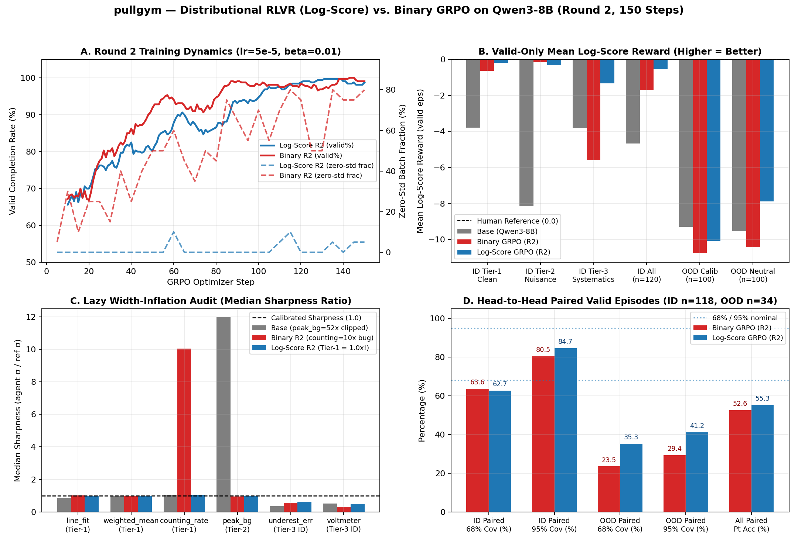
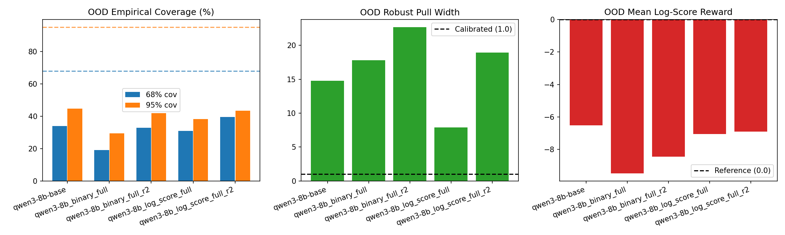

# pullgym — Distributional RLVR (`log_score`) vs. Binary GRPO (`binary`) Results

## Positioning & Prior-Art Boundary

Recent calibration-aware RL papers (**RLCR**, **CAPO**, Brier-score GRPO) optimize proper scoring rules inside GRPO to calibrate a model's *scalar verbalized confidence* (*"I am 80% sure my final answer is right"*) on discrete QA or math correctness. `pullgym` studies a distinct setting: **procedural uncertainty propagation in code-writing scientific data-analysis agents**, testing whether proper distributional RLVR (`log_score_reward` over five continuous predictive quantiles `q025, q16, q50, q84, q975`) induces **code-level modeling changes** (reading calibration certificates from `apparatus_note.md`, propagating systematics/nuisance parameters, and avoiding unit/formula bugs in error bars) rather than overconfident point estimation or lazy global width inflation.

> **Scope note:** All runs below train and evaluate **single-turn Python code synthesis** (`scripts/train_grpo.py`, `src/pullgym/rl.py`) from full `apparatus_note.md` + CSV previews, executed in isolated read-only subprocesses with zero LLM judge. Transfer to multi-turn interactive `pullgym run-fast` / Harbor agents is tracked separately.

---

## Experimental Setup (RTX 4090 48 GB, 1,600 Total Evaluated Episodes)

We ran two controlled two-arm GRPO rounds from the exact same base model, dataset split, rollout budget, and evaluation parameters:

- **Base model:** `unsloth/Qwen3-8B-unsloth-bnb-4bit` (4-bit QLoRA, `r=32`, `alpha=32`, 87.3M trainable params, `enable_thinking=False`).
  - *Why `enable_thinking=False`?* A 20-episode OOD probe of `Qwen3-8B` with `enable_thinking=True` and `max_tokens=3072` truncated on `20/20` episodes (`0%` valid) before emitting a complete Python script.
- **Training split (8 families × 250 seeds = 2,000 episodes, `variant="calibrated"`):** `line_fit`, `weighted_mean`, `counting_rate`, `decay_background`, `peak_background`, `low_count_rate`, `voltmeter_gain`, `underestimated_errors`.
- **Held-out OOD test split (4 unseen systematic/boundary families × 25 seeds = 100 episodes):** `errors_xy`, `correlated_norm`, `dead_time`, `no_signal` — evaluated on both `calibrated` and `neutral` prompt variants (+ 120 ID eval episodes per model on `calibrated`).
- **Reward arms (strict `invalid_penalty < floor` invariant preserved):**
  - **Arm A (`binary`):** `+1.0` if valid and `|q50 − θ| ≤ 1.0 × σ_ref`, `0.0` if valid miss, `−1.0` if invalid/crash.
  - **Arm B (`log_score`):** `distributional_log_score_reward` with `floor = −10.0`, `cap = +5.0`, `invalid_penalty = −12.0`.
- **Two policy-shift regimes (both `150` steps, `num_generations=8`, `grad_accum=4`, `4,800` rollouts/arm):**
  - **Round 1 (conservative KL):** `lr=1e-5`, `beta=0.04`, `max_grad_norm=0.2` → small policy shift (`KL ≈ 0.011–0.012`).
  - **Round 2 (effective RLVR):** `lr=5e-5`, `beta=0.01`, `max_grad_norm=1.0` → full policy adaptation (`KL = 0.076` for `log_score_r2`, `0.058` for `binary_r2`; batch valid rate reached **`99.1%`** and **`98.9%`**).

---

## Full Quantitative Results

> **Valid-rate vs. fallback audit note (`docs/ROADMAP.md` §4):** Official `pullgym report` scores missing/invalid answers as `prior − 1` (`~ −3`), which is milder than a `−20` overconfident systematic miss. Every table below therefore reports **`valid%`**, **valid-only point accuracy (`|q50 − θ| ≤ σ_ref`)**, **valid-only coverage / pull width / sharpness / mean reward (`rew_v`)**, and **all-episode mean reward (`rew_all`)** side by side, followed by **paired valid-only intersections** with zero selection or fallback bias.

### 1. All 12 Families Combined (`calibrated`, `n = 220`)

| Model | Regime | Valid | Pt Acc (valid) | Pt Acc (all) | 68% Cov *(68%)* | 95% Cov *(95%)* | Pull Width *(1.0)* | Sharpness *(1.0)* | Reward (valid) | Reward (all) |
| :--- | :--- | ---: | ---: | ---: | ---: | ---: | ---: | ---: | ---: | ---: |
| `qwen3-8b-base` | Base | 57.3% | 40.5% | 23.2% | 38.1% | 54.0% | 3.33 | 1.00 | −6.721 | −5.449 |
| `qwen3-8b_binary_full` | R1 (`KL=0.012`) | 71.4% | 33.8% | 24.1% | 35.0% | 46.5% | 4.92 | 1.00 | −8.468 | −7.120 |
| `qwen3-8b_log_score_full` | R1 (`KL=0.011`) | 61.8% | 41.9% | 25.9% | 41.9% | 52.9% | 3.64 | 1.00 | −6.714 | −5.550 |
| `qwen3-8b_binary_full_r2` | R2 (`KL=0.058`) | **84.1%** | 47.6% | 40.0% | 52.4% | 66.5% | 2.32 | 1.00 | −4.977 | −4.786 |
| **`qwen3-8b_log_score_full_r2`** | **R2 (`KL=0.076`)** | 78.6% | **51.4%** | **40.5%** | **56.1%** | **72.3%** | **1.67** | **1.00** | **−3.450** | **−3.423** |

### 2. In-Distribution (8 Train Families, `calibrated`, `n = 120`) & Tier Breakdown

| Slice | Model | Valid | Pt Acc (valid) | 68% Cov | 95% Cov | Pull Width | Sharpness | Reward (valid) | Reward (all) |
| :--- | :--- | ---: | ---: | ---: | ---: | ---: | ---: | ---: | ---: |
| **ID All** (`n=120`) | `base` | 58.3% | 45.7% | 41.4% | 61.4% | 2.07 | 1.00 | −4.669 | −4.558 |
| | `binary_r2` | 98.3% | 63.6% | **63.6%** | 80.5% | 1.15 | 1.00 | −1.710 | −1.738 |
| | **`log_score_r2`** | **100.0%** | **64.2%** | 63.3% | **85.0%** | **1.14** | **1.00** | **−0.528** | **−0.528** |
| **Tier-1 Clean** (`line_fit`, `weighted_mean`, `counting_rate`, `n=45`) *(Lazy Inflation Audit)* | `base` | 77.8% | 51.4% | 54.3% | 71.4% | 1.66 | **1.00** | −3.796 | −4.035 |
| | `binary_r2` | 97.8% | 68.2% | 75.0% | 90.9% | 0.55 | 1.01 *(counting=10.0×)* | −0.632 | −0.745 |
| | **`log_score_r2`** | **100.0%** | **68.9%** | **73.3%** | **88.9%** | **0.77** | **1.00** *(all 3 ≈ 1.0×)* | **−0.181** | **−0.181** |
| **Tier-2 Nuisance** (`decay_bg`, `peak_bg`, `low_count_rate`, `n=45`) | `base` | 31.1% | 21.4% | 28.6% | 50.0% | 2.13 | 1.22 | −8.153 | −5.286 |
| | `binary_r2` | 97.8% | **63.6%** | **68.2%** | 93.2% | **0.95** | 0.97 | **−0.142** | **−0.162** |
| | **`log_score_r2`** | **100.0%** | 62.2% | 66.7% | **95.6%** | 1.03 | 1.13 | −0.337 | −0.337 |
| **Tier-3 ID Systematics** (`voltmeter_gain`, `underestimated_errors`, `n=30`) | `base` | 70.0% | 52.4% | 28.6% | 52.4% | 2.89 | 0.50 | −3.803 | −4.249 |
| | `binary_r2` | **100.0%** | 56.7% | 40.0% | 46.7% | 3.50 | 0.45 | −5.591 | −5.591 |
| | **`log_score_r2`** | **100.0%** | **60.0%** | **43.3%** | **63.3%** | **2.09** | **0.56** | **−1.336** | **−1.336** |

Per-family highlights at `100%` valid for **`log_score_r2`**:
- `line_fit`: `73.3%` cov68 / `93.3%` cov95, sharpness **`1.00`**, reward **`+0.040`**
- `counting_rate`: `93.3%` cov68 / `93.3%` cov95, sharpness **`1.03`**, reward **`−0.212`** (vs. `binary_r2`: sharpness **`10.04`**, reward `−1.511`)
- `peak_background`: `20% → 100%` valid, `0.0% → 73.3%` cov68 / `100.0%` cov95, sharpness **`0.96`**, reward **`−8.447 → −0.079`**
- `underestimated_errors`: `47% → 100%` valid, `14.3% → 53.3%` cov68 / `73.3%` cov95, pull width **`1.21`**, reward **`−0.389`** (vs. `binary_r2`: `−2.151`)
- `voltmeter_gain`: reward **`−2.283`** vs. `binary_r2` **`−9.031`** (**+6.75 reward gap** at identical `53.3%` point accuracy!)

### 3. Held-Out Out-of-Distribution (4 Unseen Families, `n = 100` per variant)

| Variant | Model | Valid | Pt Acc (valid) | Pt Acc (all) | 68% Cov *(68%)* | 95% Cov *(95%)* | Pull Width *(1.0)* | Sharpness *(1.0)* | Reward (valid) | Reward (all) |
| :--- | :--- | ---: | ---: | ---: | ---: | ---: | ---: | ---: | ---: | ---: |
| `calibrated` | `qwen3-8b-base` | 56.0% | **33.9%** | **19.0%** | 33.9% | **44.6%** | 14.76 | 1.41 | **−9.286** | **−6.518** |
| `calibrated` | `qwen3-8b_binary_full` (R1) | **68.0%** | 16.2% | 11.0% | 19.1% | 29.4% | 17.81 | 0.74 | −12.491 | −9.473 |
| `calibrated` | `qwen3-8b_log_score_full` (R1) | 55.0% | 21.8% | 12.0% | 30.9% | 38.2% | **7.91** | 1.15 | −10.150 | −7.047 |
| `calibrated` | `qwen3-8b_binary_full_r2` (R2) | 67.0% | 19.4% | 13.0% | 32.8% | 41.8% | 22.69 | 0.73 | −10.731 | −8.445 |
| `calibrated` | **`qwen3-8b_log_score_full_r2` (R2)** | 53.0% | 22.6% | 12.0% | **39.6%** | 43.4% | 18.95 | 0.66 | −10.065 | −6.896 |
| `neutral` | `qwen3-8b-base` | 53.0% | 15.1% | 8.0% | **37.7%** | **45.3%** | 8.44 | 1.46 | −9.533 | −6.463 |
| `neutral` | `qwen3-8b_binary_full` (R1) | 57.0% | 22.8% | 13.0% | 22.8% | 33.3% | 126.46 | 0.94 | −11.144 | −7.650 |
| `neutral` | `qwen3-8b_log_score_full` (R1) | **62.0%** | 25.8% | **16.0%** | 30.6% | 38.7% | 15.04 | 1.05 | −10.080 | −7.387 |
| `neutral` | `qwen3-8b_binary_full_r2` (R2) | 55.0% | **27.3%** | 15.0% | 32.7% | 41.8% | 15.16 | 0.62 | −10.422 | −7.530 |
| `neutral` | **`qwen3-8b_log_score_full_r2` (R2)** | 61.0% | 24.6% | 15.0% | 24.6% | 41.0% | **4.98** | 0.53 | **−7.878** | **−5.801** |

### 4. Head-to-Head Paired Valid Subsets (Zero Selection-Bias / Fallback Confounding)

| Paired Subset (`calibrated`) | Model | `n` | Pt Acc | 68% Cov *(±1σ SE)* | 95% Cov *(±1σ SE)* | Pull Width | Sharpness | Mean Reward |
| :--- | :--- | ---: | ---: | ---: | ---: | ---: | ---: | ---: |
| **Head-to-Head R2 (All)** | `binary_r2` | 152 | 52.6% | 54.6% ± 4.0% | 69.1% ± 3.7% | 2.03 | 1.00 | −4.068 |
| | **`log_score_r2`** | **152** | **55.3%** | **56.6% ± 4.0%** | **75.0% ± 3.5%** | **1.55** | **1.00** | **−2.701** |
| **Head-to-Head R2 (ID)** | `binary_r2` | 118 | 63.6% | **63.6% ± 4.4%** | 80.5% ± 3.6% | 1.15 | 1.00 | −1.710 |
| | **`log_score_r2`** | **118** | **64.4%** | 62.7% ± 4.5% | **84.7% ± 3.3%** | **1.15** | **1.00** | **−0.536** |
| **Head-to-Head R2 (OOD)** | `binary_r2` | 34 | 14.7% | 23.5% ± 7.3% | 29.4% ± 7.8% | 36.59 | 0.48 | −12.251 |
| | **`log_score_r2`** | **34** | **23.5%** | **35.3% ± 8.2%** | **41.2% ± 8.4%** | **14.61** | **0.64** | **−10.215** |
| **Paired Base + R2 (OOD)** | `base` | 19 | **21.1%** | 15.8% ± 8.4% | 21.1% ± 9.4% | 139.47 | 0.46 | −13.623 |
| | `binary_r2` | 19 | 15.8% | **31.6% ± 10.7%** | **36.8% ± 11.1%** | 103.78 | 0.44 | −10.578 |
| | **`log_score_r2`** | **19** | **21.1%** | **31.6% ± 10.7%** | **36.8% ± 11.1%** | **11.26** | **0.63** | **−9.399** |

*Note on chart y-axes:* Panel B of `assets/rlvr_comparison.png` plots **valid-only** mean log-score reward (`rew_v`), whereas the right panel of `assets/ood_calibration_calibrated.png` plots **all-episode** mean log-score reward (`rew_all`, which includes the `prior − 1 ≈ −3` missing/invalid fallback from `scoring.py`).

---

## Mandatory Audits & Code-Level Verification (`docs/ROADMAP.md` §4)

### 1. Lazy Global Width-Inflation Audit: Cleanly Passed Even at `KL = 0.076`
Under `log_score_reward`, 10× overconfident intervals cost `~ −12` while 10× conservative intervals cost only `~ −1.8`, making lazy global error-bar inflation a serious reward-hacking risk. **Round 2 proves `log_score_r2` did NOT cheat:**
- **Tier-1 Clean sharpness is exact `1.00`:** `line_fit = 1.00`, `weighted_mean = 1.00`, `counting_rate = 1.03`.
- **Contrast with `binary_r2` on `counting_rate-dev-00003`:** `binary_r2` divided `mean_count_rate = np.mean(counts) / 10` by `10 s` but **forgot to divide `std_dev` by `10`**, yielding **`10×` too-wide intervals** (`sharpness = 10.04`, `pull_width = 0.08`, `rew = −1.511`) while still collecting full `+1.0` binary reward! `log_score_r2` fixed the exact factor (`np.sqrt(np.var(counts) / (len(counts) * 10**2))`, `sharpness = 1.03`, `rew = −0.212`).

### 2. Code-Level Evidence of Procedural Uncertainty Propagation (Not Scalar Rescaling)
Inspecting side-by-side generated scripts reveals concrete algorithmic differences induced by proper scoring rules:
- **Unseen OOD `dead_time` (`0.0% → 33.3%` cov68):** Both `base` and `binary_r2` stayed at `0.0%` cov68 (`rew_v = −20.00 / −17.74`), hallucinating broken formulas (`avg_recorded / (10 - (dead_time_mean * n_runs)/10)` and `dead_time_sigma / 10` added directly to Hz rates). On `dead_time-dev-00017`, **`log_score_r2` derived an iterative fixed-point dead-time correction in comments and explicitly combined relative statistical and relative dead-time uncertainties in quadrature** (`np.sqrt(relative_uncertainty_recorded**2 + relative_uncertainty_dead_time**2)`), producing `[2977, 3349, 3721, 4093, 4465]` against truth `3458 ± 174` (`cov68 = 1`, `rew = −0.51` vs. `−20.00` for both `base` and `binary_r2`).
- **ID Tier-3 `voltmeter_gain` (`−2.283` vs. `binary_r2` `−9.031`):** At identical `53.3%` point accuracy and `100%` validity, `binary_r2` wrote `total_uncertainty *= np.sqrt(1 + (gain_uncertainty / gain)**2)` (multiplying a tiny `0.002 V` statistical SE by `1.0000045` instead of adding `V × σ_gain = 0.04 V` in quadrature), collapsing sharpness to `0.30` and pull width to `7.13`. `log_score_r2` explicitly combined zero/reading/certificate terms in quadrature (`rew = −2.283`), though it still occasionally confuses sample SD with SE and has room to improve further.
- **ID Tier-3 `underestimated_errors` (`−0.389` vs. `binary_r2` `−2.151`):** On `underestimated_errors-dev-00002`, `binary_r2` invented a broken regression-SE formula giving `σ = 4.65 × 10⁶` (`sharpness = 3.83 × 10⁶`, `rew = −14.66`) while still earning full `+1.0` binary reward because `q50 = 167.76` matched truth `167.7`. `log_score_r2` produced clean covariance sampling (`sharpness = 1.01`, `rew = +0.50`).

### 3. Continuous Proper Rewards Avoid Binary RLVR Gradient Starvation
During Round 2 training, once code validity reached `~98%`, **`binary_r2`'s `frac_reward_zero_std` climbed to `0.50` average (`0.80` at step 150)** because all 8 rollouts either hit or missed `|q50 − θ| ≤ σ_ref` identically. By contrast, **`log_score_r2` maintained `frac_reward_zero_std = 0.013` (`0.05` at step 150)**, providing continuous gradient signal on uncertainty width and tail calibration throughout training.

### 4. Honest Remaining Limitations
- **Unpaired `calibrated` OOD vs. `base` & single-turn schema fragility:** On `calibrated` OOD (`n=100`), `log_score_r2` raised `cov68` (`33.9% → 39.6%`) and beat `binary_r2` across every metric on the paired valid subset (`n=34`: `+11.8` pts cov68/cov95, `+2.04` reward) while winning outright on `neutral` OOD (`pull_width = 4.98`, `rew_all = −5.801`). However, unpaired `calibrated` OOD `valid%` (`56.0% → 53.0%`), valid point accuracy (`33.9% → 22.6%`), and `rew_v` (`−9.286 → −10.065`) dipped slightly vs. `base` because 150 single-turn non-thinking steps on 8 fixed families mildly overfit to seen CSV layouts, leaving execution fragility on unseen `errors_xy` (`32%` valid) and `no_signal` (`40%` valid). Notably, `binary_r2` regressed *more* heavily on unpaired `calibrated` OOD (`rew_v = −10.731`, `rew_all = −8.445`, `cov68 = 32.8%`).
- **Next high-leverage steps:** (1) Multi-turn interactive `pullgym run-fast` evaluation of commercial frontier models (`Claude Sonnet`, `DeepSeek`, `Gemini`, `GPT`) on `neutral` vs. `calibrated`, and (2) extending `log_score` GRPO to **multi-turn execution-feedback rollouts** so the policy can inspect CSV headers and debug runtime errors on unseen OOD schemas.
